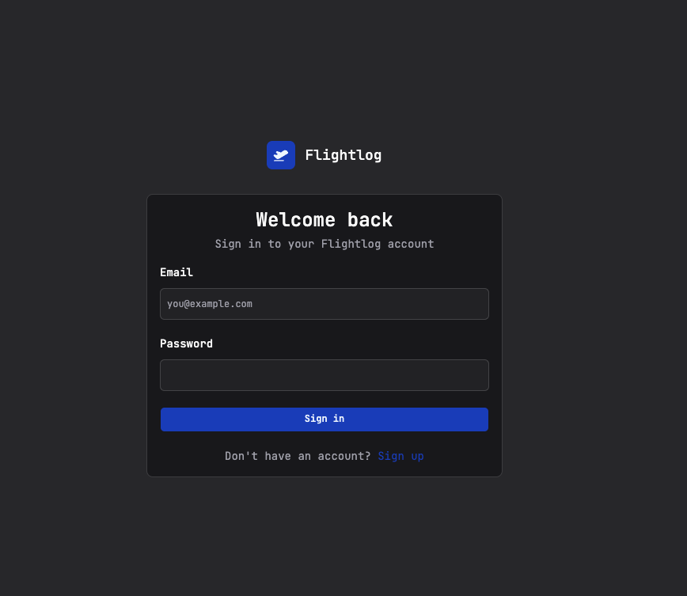

# Accounts & signing in

Flightlog is a single-tenant app in spirit but supports multiple accounts — useful if you share an instance with a partner or family member who wants their own logbook.



## Creating your account

The first time you open Flightlog you'll land on the **Sign in** screen above. There's no separate admin step or invite flow — just:

1. Click **Sign up** at the bottom of the card.
2. Enter your email and a password.
3. You're in. The next time you visit, sign in with the same credentials.

That's the entire account setup. Sessions are signed with the `AUTH_JWT_SECRET` you set during deployment, so they survive container restarts but will all log out if you rotate that secret.

## Each account = its own logbook

Flights, dashboard totals, imports and exports are all scoped to the signed-in user. Two accounts on the same instance share:

- The **AeroDataBox cache** — if account A looks up `BA 117 on 2026-04-12` and account B does the same search later, B gets the cached result and **no extra API call is made**. Helpful for shared households.
- Nothing else. Account A can't see account B's flights, totals, or exports.

## Changing your password

Open the user menu at the bottom of the sidebar and choose **Settings**. Under **Change password**, enter your current password and a new one of at least 8 characters.

## Deleting your account

The same **Settings** dialog has a **Delete account** section. Enter your password, confirm, and your account and flight collection are removed for good — [export](import-export.md#export) first if you want to keep a copy. Flight data cached from AeroDataBox stays on the instance, since other accounts may be using it.

## Closing sign-ups

By default anyone who can reach your instance can create an account. Once you (and anyone you share with) have signed up, set `AUTH_REGISTRATION_ENABLED=false` and restart — see [Configuration](../getting-started/configuration.md#optional). The **Sign up** link disappears and new registrations are refused.

## Forgetting a password

There's no reset-by-email flow — Flightlog doesn't send email. Instead, whoever runs the instance can reset any account's password from the command line:

```bash
docker compose exec -u flightlog flightlog ./main reset-password you@example.com
```

It prints a new random password. Sign in with it, then pick your own under **Settings**. Every existing session for that account is signed out.

!!! tip "Use a password manager"
    Since resetting needs access to the server, treat your Flightlog credentials like any other self-hosted app — store the password in 1Password / Bitwarden / your manager of choice and you'll never have to think about it again.
