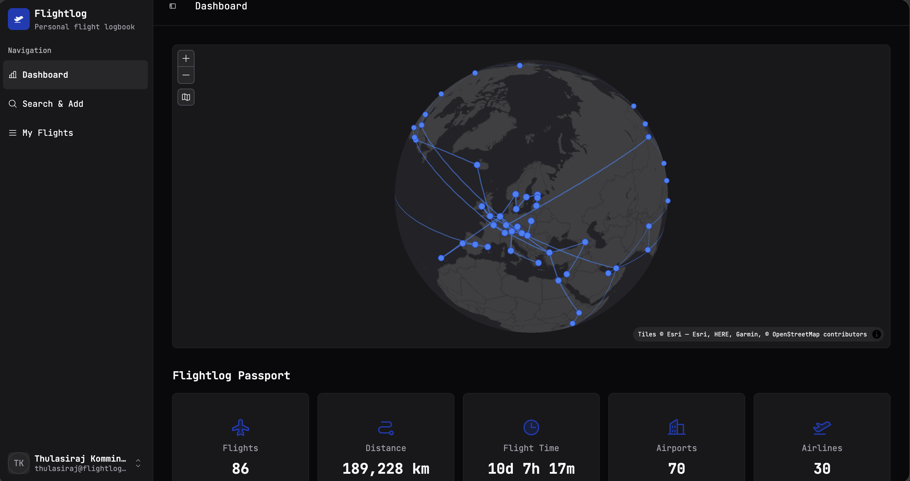

# Dashboard

The dashboard is the headline view — the page you'll keep open in a browser tab and show people when they ask "wait, how many flights _have_ you been on?"

It has two halves.

## The map

Every flight you've flown is drawn as a line between two airport dots, on a globe you can drag to rotate and scroll to zoom. Hover over a dot to see which airport it is. Routes follow the great circle — the path the aircraft actually flies — so long-haul routes curve the way you'd expect.

The button under the zoom controls switches to a flat world map, handy when you want to see every route at once. A flat map can't show a route across the Pacific date line in one piece, so there those routes leave through one edge of the map and come back in through the opposite edge; switch back to the globe to see them in one piece.

A few things worth knowing:

- **Same route, multiple times = one line.** The visual won't get noisier the more you fly the same hop — but the underlying flight count _will_ increase, so the **Flights** total below stays honest.
- **Airports without coordinates won't draw a line.** This basically never happens in practice (the bundled airport database covers all the commercial ones) but if a flight ever fails to render on the map, it's almost certainly that the AeroDataBox response didn't include a recognised IATA/ICAO code.

## Flightlog Passport

The five tiles under the map summarise every flight you've actually flown:

| Tile            | What it counts                                                           |
| --------------- | ------------------------------------------------------------------------ |
| **Flights**     | Every flown flight, including duplicates (a round-trip is two flights).  |
| **Distance**    | Sum of all the great-circle distances, in kilometres.                    |
| **Flight Time** | Sum of scheduled flight durations across everything you've flown.        |
| **Airports**    | Unique airports you've passed through (departure _or_ arrival).          |
| **Airlines**    | Unique airlines you've flown.                                            |

These update in real time as you add or delete flights — there's no "refresh stats" button, and there doesn't need to be one.

!!! note "Only flown flights count"
    A flight that is still upcoming, or was **Cancelled** or **Diverted**, stays in your log (so your history is complete) but doesn't add to the map or to any of the tiles. Upcoming flights are picked up automatically once they land. AeroDataBox can't confirm a landing at every airport, so a flight that is still marked **Scheduled** a day after its date is counted as flown too.

## What's not on this page

The dashboard is deliberately read-only — there's nothing to click that takes you off it except the sidebar. If you want to add flights, head to [Search & Add](search-and-add.md). To dig into your log, see [My Flights](my-flights.md).
